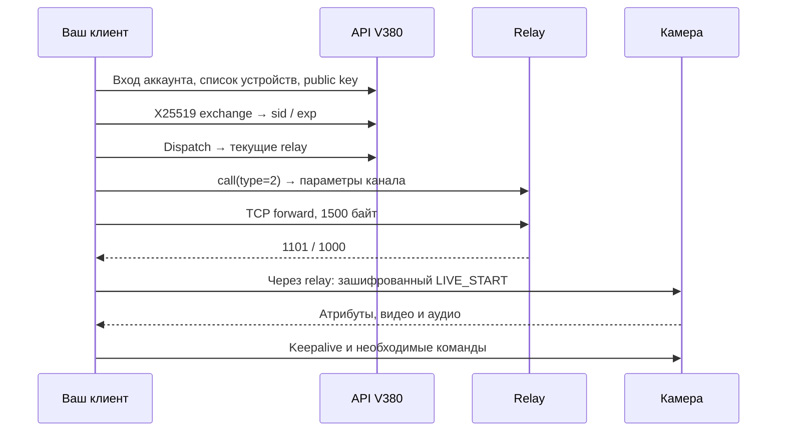

# V380 HSC — практическое руководство по протоколу

Как подключить собственную HSC-камеру V380 Pro из своего клиента:
вход аккаунта, получение ключа, X25519/AES, облачный relay, бинарные пакеты IOTC,
видео и звук, управление поворотом/светом и чтение SD-записей.

Это **репозиторий документации**. Здесь нет сайта, веб-плеера, серверного приложения,
S3-инфраструктуры, готового клиента, записей с камер и личных конфигураций.
Небольшие фрагменты кода находятся только внутри руководства и поясняют формат.

Описание восстановлено по исходному снимку клиента для V380 Pro **2.2.81**.
Наблюдения относятся к HSC-семейству, а не ко всем камерам под брендом V380.
Состояние материала: **29 октября 2026 года**. Это не официальный SDK производителя.

## Что читать

| Раздел | Что получится понять |
|---|---|
| [1. Совместимость и маршрут подключения](docs/01-overview.md) | Нужные данные и последовательность обмена |
| [2. Облачный API, подписи и ключи](docs/02-api-and-keys.md) | Авторизация аккаунта, список устройств, X25519-сессия |
| [3. Relay и IOTC](docs/03-relay-and-iotc.md) | TCP handshake, заголовки, secure type, live и keepalive |
| [4. Видео, звук и временные метки](docs/04-media.md) | Выборочное AES-дешифрование, HEVC/H.264, PCM/IMA ADPCM |
| [5. PTZ и свойства камеры](docs/05-controls.md) | Чтение/запись DPID, поворот, STOP, свет и ночное видение |
| [6. Список и чтение SD-записей](docs/06-sd.md) | Пагинация, времена, окно frames и обновление сессии |
| [7. Диагностика](docs/07-troubleshooting.md) | Как найти этап отказа и проверить полученное медиа |
| [8. Проверка документации](docs/08-validation.md) | Что сверено в этом выпуске и что ещё не установлено |

## Короткий маршрут

Первый результат — получить **декодируемый видеокадр**, а не только успешный HTTP-ответ.
Затем можно добавлять звук, управление и SD-чтение.

## Совместимость и доступ

В исходном описании указана проверенная 4G HSC-камера **HSC V3L4GXHR**:
ПО `V2.0.2.6(HSC_V3L4GXHR_20250419)`, прошивка `Hw_EV3L_NG1__4G_20250419`.
В этом выпуске подключение к устройству повторно не выполнялось.

Клиент использует облако производителя для входа, ключей и relay. Работа без
запущенного приложения на телефоне не означает независимость от этого облака.
Нужны учётная запись с доступом к камере и её ID. QR или один ID не заменяют авторизацию.

Указанные соли/константы — части наблюдавшегося протокола. Вымышленный ID
`123456789` и строки `TOKEN`, `BASE64_*` — заполнители. Рабочих токенов, ключей,
QR-кодов, адресов личных серверов или идентификаторов камер здесь нет.

## Источник и использование

Материал переработан из предоставленного автором архива; конкретные источники,
контрольные суммы и границы достоверности — в [SOURCES.md](SOURCES.md).
Текст руководства распространяется по **CC BY 4.0** с указанием FoxCoderGit.
Это не лицензия на приложение V380 Pro, его библиотеки или сервисы производителя.
